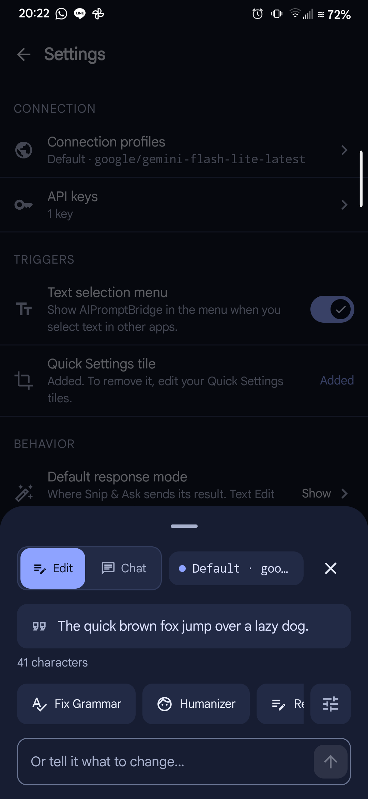
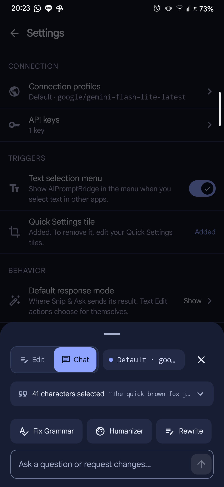
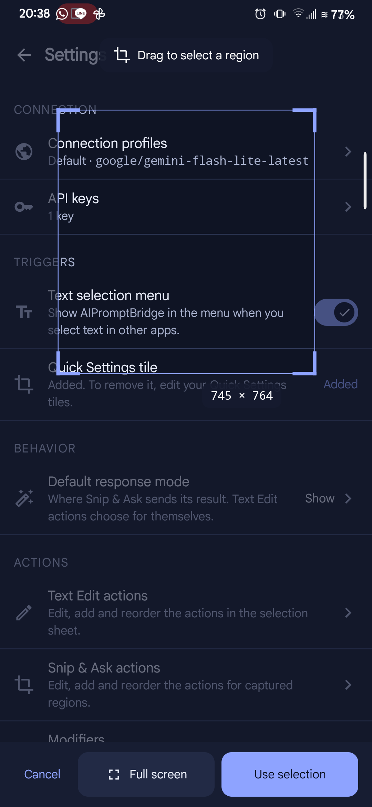
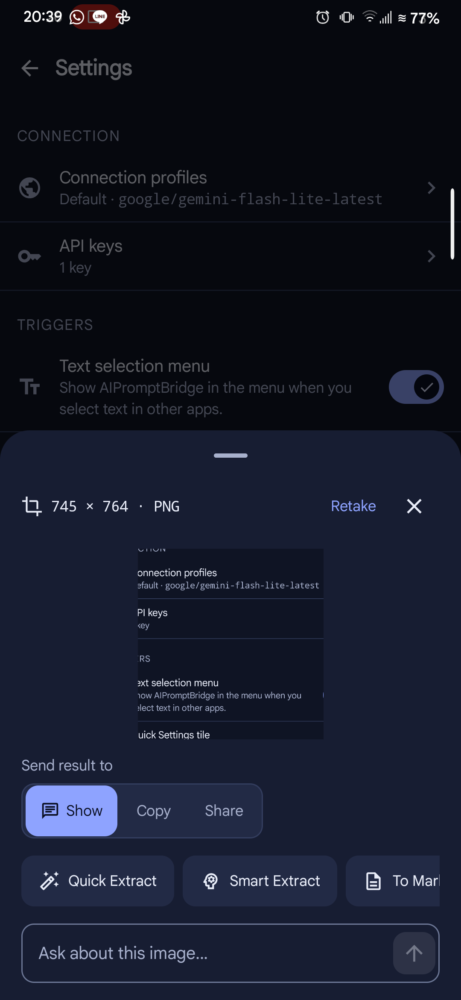
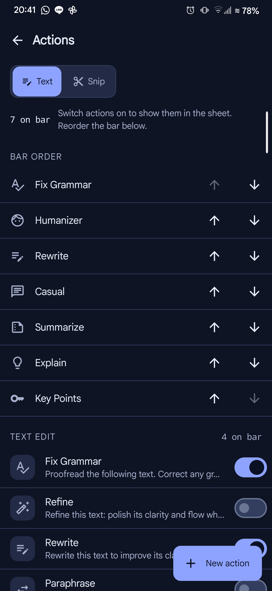
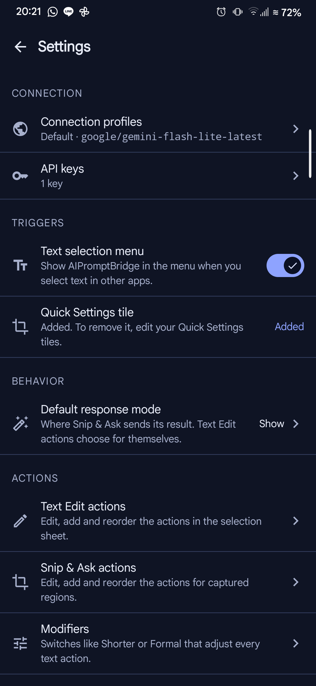

# AIPromptBridge for Android

[](https://kotlinlang.org)
[-green.svg)](https://android.com)
[](https://developer.android.com/jetpack/compose)
[](https://github.com)
[](LICENSE)

A native Android port of the desktop assistant **[AIPromptBridge](https://github.com/zaxx-q/AIPromptBridge)**. It integrates AI text processing and visual screen analysis directly into the Android operating system with zero friction.

---

## ✨ Features

### 🎯 Text Edit (`PROCESS_TEXT`)

Select text in **any** application (Chrome, Keep, Gmail, WhatsApp, Telegram, etc.), open the selection toolbar, and tap **AIPromptBridge**:

<p align="center">
  
</p>

- **One-Tap Actions**: Fix Grammar, Humanizer, Rewrite, Casual, Summarize, Explain, Key Points, and more.
- **Word Diff Visualization**: Color-coded inline diff showing additions (highlighted) and deletions (struck through).
- **Direct Replacement**: Tap **Replace selection** to swap the text in-place in editable fields, or copy the result if the source is read-only.
- **Tune & Modifiers**: Quickly apply modifiers (Shorter, More Formal, Variations, Language translation) without modifying base prompts.
- **Free-form Instructions**: Enter custom refinement instructions alongside preset actions.

---

### 💬 Interactive Chat Mode

Need to ask follow-up questions or iterate on selected text? Switch directly to Chat mode from the bottom sheet:

<p align="center">
  
</p>

- **Context-Preserving**: The selected text is pinned in a collapsible header pill and automatically seeds the conversation context.
- **Multi-Turn Dialogue**: Ask for alternative variations, explanations, or specific stylistic adjustments.
- **Inline Action Bar**: Copy or replace text directly from AI response blocks.

---

### 📸 Snip & Ask

Capture any portion of your screen and analyze it with multimodal AI using a Quick Settings tile:

<p align="center">
  
  &nbsp;&nbsp;&nbsp;&nbsp;
  
</p>

- **Instant QS Trigger**: Tap the **Snip & Ask** Quick Settings tile from any screen.
- **Clean Frame Grab**: Foreground service capture grabs the exact screen content without capturing the notification shade or consent dialog.
- **Touch Region Selector**: Drag a selection rectangle with live dimension readouts (`W × H` px) or tap **Full screen**.
- **Visual AI Actions**: Quick OCR Extract, Smart Extract, OCR to Markdown, or ask custom questions about the image.
- **Flexible Destinations**: Send results directly to a Chat window, copy to clipboard, or share to other apps.
- **Image-Aware Follow-up**: Continue in chat carries the cropped screenshot forward across follow-up queries.

---

### 🛠️ Prompt & Action Editor

Full control over how every action behaves:

<p align="center">
  
</p>

- **Bar Order Management**: Reorder actions and choose which actions appear on the one-tap sheet.
- **Full Customization**: Edit system instructions, task prompts, output constraints, icons, and groups.
- **Modifier Editor**: Adjust prompt modifiers or define new ones.
- **Safe 3-Way Merge**: User modifications are preserved across app updates while receiving new default actions automatically.

---

### 🔒 Settings & Security

<p align="center">
  
</p>

- **Multi-Provider Support**: Google Gemini, OpenAI, Anthropic Claude, OpenRouter, xAI (Grok), Mistral, Cohere, and custom OpenAI-compatible endpoints.
- **Automatic Key Rotation**: Add multiple API keys per provider; rate limits (`429`, `401`, `403`) automatically rotate to the next key.
- **Hardware-Backed Encryption**: API keys are encrypted at rest using **Android Keystore AES-GCM** authenticated encryption. Keys never appear in plaintext logs or backups (`allowBackup="false"`).
- **Appearance**: Seamless Light and Dark theme modes following Material 3 guidelines and Stitch design tokens.

---

## 🏗️ Architecture

AIPromptBridge is built as a clean two-module Android project:

- **`:core`** (Pure Kotlin / JVM): Providers, template-method retry/rotation logic, key pools, profile resolution, prompt composition, LCS word diffing, crop geometry, and persistence. Completely decoupled from Android dependencies with 152 fast JVM unit tests.
- **`:app`** (Android / Jetpack Compose): Compose UI, system integrations (`ACTION_PROCESS_TEXT`, Quick Settings tile, `MediaProjection` foreground service capture), navigation, and Keystore crypto.

```
core/ (Pure Kotlin/JVM)               app/ (Android Compose)
  ├── provider/ (Gemini, OpenAI...)     ├── feature/textedit/ (ProcessTextActivity, sheet)
  ├── prompt/   (Catalog, Composer)     ├── feature/snip/     (Tile, SnipActivity, crop)
  ├── keys/     (KeyPool, rotation)     ├── feature/settings/ (Settings, profiles, keys)
  ├── profile/  (Profiles, resolver)    ├── feature/prompteditor/ (Actions, modifiers)
  ├── diff/     (WordDiff LCS)          ├── designsystem/     (Theme, tokens, components)
  └── engine/   (AiEngine facade)       └── data/             (Keystore cipher, transport)
```

For detailed architecture diagrams, design decisions, and request flows, see [DEVELOPMENT.md](docs/DEVELOPMENT.md).

For the Kotlin learning concepts mapping, see [CONCEPTS.md](CONCEPTS.md).

---

## 🚀 Getting Started

### Prerequisites
- **Android Studio Ladybug / Quail (2024.2+)**
- **JDK 17+**
- **Android SDK Platform 37** (`compileSdk = 37`, `minSdk = 30`, `targetSdk = 36`)
- Android device or emulator running **Android 11+ (API 30+)**

### Building and Running

1. **Clone the repository:**
   ```bash
   git clone https://github.com/zaxx-q/aipromptbridge-android.git
   cd aipromptbridge-android
   ```

2. **Run tests:**
   ```bash
   ./gradlew :core:test
   ```

3. **Install debug build:**
   ```bash
   ./gradlew :app:installDebug
   ```

### Setup & Usage

1. **Configure API Keys:**
   - Launch **AIPromptBridge** from the app drawer.
   - Go to **API keys**, select your provider (e.g., Google Gemini or OpenAI), and enter your API key(s).
   - Set up your preferred connection profile and active model.
2. **Use Text Edit:**
   - Highlight any text in Chrome, Keep, Notes, or any app.
   - Tap the overflow menu (⋮ / More) on the text toolbar and choose **AIPromptBridge**.
   - Select an action (e.g., *Fix Grammar*) or ask a question in chat mode.
3. **Use Snip & Ask:**
   - In Settings, tap **Add** under Quick Settings tile (or add the tile manually from your notification shade).
   - Swipe down your quick settings shade and tap **Snip & Ask**.
   - Accept the screen capture prompt, drag to select any region, and choose an action.

---

## 📚 Technical Documentation

- [DEVELOPMENT.md](docs/DEVELOPMENT.md) — Architectural patterns, request pipelines, implementation history, and future stretch roadmap.
- [CONCEPTS.md](CONCEPTS.md) — Kotlin language features and OOP rubric mapping.
- [DESIGN_NOTES.md](docs/DESIGN_NOTES.md) — Stitch UI design system tokens, typography, and contrast specifications.
- [ORIGINAL_NOTES.md](docs/ORIGINAL_NOTES.md) — Background and behavior parity notes from the desktop Python application.

---

## 📄 License

This project is open-source software licensed under the [MIT License](LICENSE).
